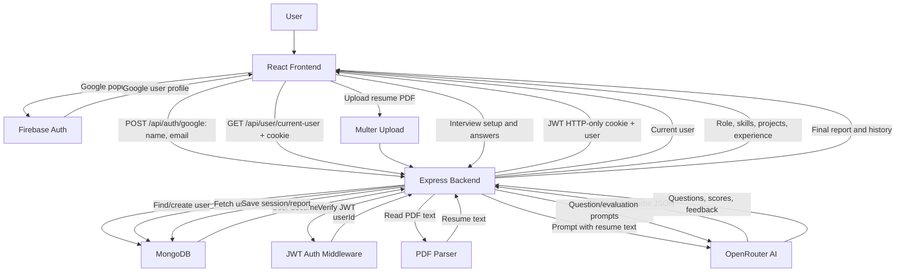

# InterviewIQ.AI Project Status Report

Date: July 29, 2026

## 1. Current Completion Status

Overall project status: approximately 45% complete.

The project has a working foundation: React frontend, Express backend, Google/Firebase sign-in flow, JWT cookie auth, MongoDB user model, basic routing, resume PDF parsing endpoint, OpenRouter AI service integration, local env alignment, lint/build checks, and health-check support.

The project is not production-ready yet. The main missing work is the real interview experience: setup form, question generation, live interview flow, answer capture, scoring, reports, history, credits/payment behavior, and full persistence.

| Area | Status | Completion |
| --- | --- | --- |
| Frontend app shell and landing page | Mostly complete | 75% |
| Google sign-in UI and Firebase popup | Partially complete | 60% |
| Backend Express server | Mostly complete | 70% |
| JWT cookie authentication | Mostly complete | 65% |
| MongoDB user persistence | Partially complete | 55% |
| Resume PDF analysis endpoint | Partially complete | 50% |
| Interview setup, live interview, and report screens | Placeholder only | 15% |
| Interview history and analytics | Not implemented | 5% |
| Credits/payment system | UI hint only | 10% |
| Production security, deployment, testing, monitoring | Not ready | 15% |

## 2. Completed Tasks

1. Project structure is split into `client` and `server`.
2. React frontend is configured with Vite.
3. Tailwind CSS and animation/icon libraries are installed and used.
4. Redux store and user slice are available for user session state.
5. Main frontend routes exist for home, auth, interview, and reports.
6. Landing page UI exists with feature sections, modes, navbar, and footer.
7. Firebase app is configured for Google sign-in.
8. Google auth UI calls Firebase popup and then sends user details to backend.
9. Express backend is configured with CORS, cookies, JSON parsing, and API routes.
10. Backend route groups exist for auth, user, and interview APIs.
11. Google auth backend endpoint creates or finds users in MongoDB.
12. JWT token generation is implemented.
13. Auth middleware validates JWT cookie and attaches `userId`.
14. Current-user endpoint returns the logged-in user.
15. MongoDB connection helper exists with env fallback support.
16. Resume upload middleware exists using Multer.
17. Resume analysis endpoint extracts PDF text using `pdfjs-dist`.
18. Resume text can be sent to OpenRouter for structured role, experience, projects, and skills.
19. API health endpoint was added at `/api/health`.
20. Local backend URL was corrected from `8000` to `3000`.
21. CORS now supports local frontend origins.
22. Normal logged-out state now returns `401` instead of noisy `400`.
23. Frontend auth check no longer logs scary errors for expected logged-out users.
24. Auth errors are displayed on the login page.
25. Server startup no longer crashes immediately if MongoDB connection fails.
26. Client lint passes.
27. Client production build passes.
28. Server syntax check passes.
29. Backend health check returns `{"status":"ok"}`.
30. `.env.example` files were added for client and server.

## 3. Remaining Tasks

1. Build the real interview setup screen.
   - Add role selection.
   - Add experience level.
   - Add interview type: HR, technical, resume-based, mixed.
   - Add resume upload option.
   - Validate all setup inputs.

2. Complete resume-based interview flow.
   - Connect frontend upload UI to `/api/interview/analyze-resume`.
   - Show extracted role, skills, projects, and experience.
   - Let user confirm or edit extracted data.
   - Store extracted resume data in database.

3. Implement AI question generation.
   - Create backend endpoint for generating first question.
   - Include role, experience, skills, projects, and interview type in AI prompt.
   - Store generated questions.
   - Add retry/error handling for AI failures.

4. Implement live interview screen.
   - Display current question.
   - Capture typed or spoken answers.
   - Add timer logic.
   - Add next-question flow.
   - Add loading states.
   - Add graceful failure states.

5. Implement follow-up questions.
   - Send candidate answer to backend.
   - Ask AI for contextual follow-up.
   - Limit total questions per interview.
   - Save question-answer history.

6. Implement answer evaluation.
   - Score technical accuracy.
   - Score clarity and communication.
   - Score confidence or completeness.
   - Generate strengths, weaknesses, and improvement suggestions.

7. Implement final report.
   - Show overall score.
   - Show per-question feedback.
   - Show recommended topics to study.
   - Show downloadable report option.
   - Save report in database.

8. Implement interview history.
   - Create interview model schema.
   - Save each interview session.
   - Add history API.
   - Build frontend history page.
   - Add filters by role, date, score, and interview type.

9. Implement analytics.
   - Track score improvement over time.
   - Track weak topics.
   - Track completed interview count.
   - Add simple charts.

10. Complete credits system.
    - Decide credit cost per interview.
    - Deduct credits only after interview starts successfully.
    - Add backend validation.
    - Add transaction-safe update.
    - Add UI for insufficient credits.

11. Complete payment integration if credits are paid.
    - Add Razorpay order creation.
    - Verify payment signature.
    - Update user credits after verified payment only.
    - Add payment history.

12. Improve authentication security.
    - Use secure cookies in production.
    - Configure `sameSite` based on environment.
    - Add logout cookie options matching login cookie options.
    - Add stronger error handling for expired tokens.

13. Add production environment support.
    - Separate local and production env values.
    - Add production frontend URL to CORS.
    - Add deployment instructions.
    - Add secret management guidance.

14. Add automated tests.
    - Backend auth tests.
    - Backend route tests.
    - Resume upload tests.
    - AI service mock tests.
    - Frontend render and flow tests.

15. Add production quality controls.
    - Request rate limiting.
    - Input validation.
    - File type validation.
    - File cleanup guarantees.
    - Central error handler.
    - Logging and monitoring.

## 4. Complete Project Workflow

1. User opens frontend app.
2. Frontend checks `/api/user/current-user`.
3. If the user is not logged in, frontend redirects to auth page.
4. User clicks Continue with Google.
5. Firebase opens Google sign-in popup.
6. Firebase returns Google user profile to frontend.
7. Frontend sends `name` and `email` to backend `/api/auth/google`.
8. Backend finds or creates user in MongoDB.
9. Backend signs JWT and stores it in an HTTP-only cookie.
10. Frontend stores returned user in Redux.
11. User opens the interview flow.
12. User chooses role, experience level, and interview type.
13. If resume-based mode is selected, user uploads PDF resume.
14. Frontend sends resume to backend.
15. Backend extracts PDF text.
16. Backend sends resume text to OpenRouter AI.
17. AI returns structured resume data.
18. Backend returns role, experience, projects, skills, and resume text.
19. User confirms setup.
20. Backend generates first interview question using AI.
21. Frontend displays question.
22. User answers question.
23. Backend evaluates answer and optionally generates a follow-up.
24. Steps 21-23 repeat until interview ends.
25. Backend creates final report.
26. Backend saves interview session and report in MongoDB.
27. Frontend displays final report.
28. User can review history and download/share report.

## 5. Data Flow Diagram

## 6. Production-Ready Recommendations

1. Replace placeholder interview screens with complete user flows before production.
2. Create a real `Interview` schema and persist sessions, questions, answers, scores, and reports.
3. Add strict request validation with a library such as Zod or Joi.
4. Validate uploaded files by MIME type and extension.
5. Store uploads in a dedicated temporary folder and ensure cleanup always runs.
6. Add rate limiting to auth, AI, and upload endpoints.
7. Add centralized backend error handling.
8. Avoid returning raw internal error messages to users in production.
9. Move all secrets to deployment secret storage.
10. Use `JWT_SECRET`, `MONGO_DB`, and `OPENROUTER_API_KEY` consistently instead of older fallback names.
11. Configure secure cookies for production: `secure: true` over HTTPS.
12. Add environment-specific CORS configuration.
13. Add tests before changing the interview flow heavily.
14. Mock OpenRouter in tests to avoid cost and flaky network failures.
15. Add loading, empty, and error UI states on every API-driven page.
16. Add analytics only after interview data is persisted reliably.
17. Add payment verification before enabling paid credits.
18. Add logging and monitoring for API errors and AI failures.
19. Add deployment documentation for frontend and backend.
20. Remove generated logs and `node_modules` from source control if this project is later committed.

## 7. Summary

The project has a solid start and the local foundation now runs cleanly. The completed work is mainly infrastructure, auth, server routing, env fixes, and early resume analysis. The remaining work is mostly product functionality: the actual interview engine, scoring, persistence, history, analytics, credits, payments, and production hardening.

Recommended next milestone: complete the interview setup and first AI question generation flow, then persist one complete interview session from start to report.

