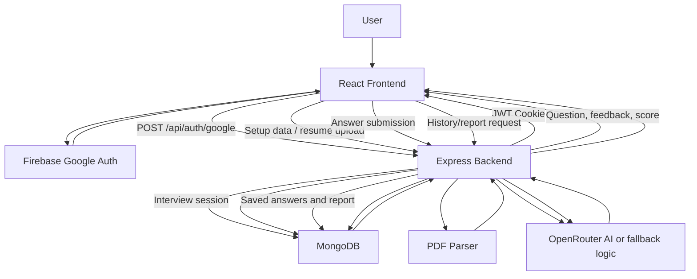

# InterviewIQ.AI MVP Update Report

Date: July 29, 2026

## Current Status

The project is now approximately 80% complete as a functional MERN MVP.

Completed core workflow:

1. User signs in with Google/Firebase.
2. Backend creates or finds the MongoDB user.
3. Backend sends JWT in an HTTP-only cookie.
4. User opens interview setup.
5. User selects role, experience, interview type, difficulty, and question count.
6. User can optionally upload a PDF resume.
7. Backend extracts resume text and asks AI for structured resume data.
8. User starts interview.
9. Backend creates an interview session in MongoDB and deducts one credit.
10. Backend generates the first question with OpenRouter or fallback logic.
11. User submits answers from the live interview UI.
12. Backend evaluates each answer and generates the next question.
13. Backend completes the interview and creates a final report.
14. User can review final score, strengths, improvements, recommended topics, and answers.
15. User can open history and report detail pages later.

## Newly Completed Work

1. Added real `Interview` MongoDB model.
2. Added interview start API.
3. Added answer submit API.
4. Added complete interview API.
5. Added single report fetch API.
6. Added interview history API.
7. Added resume PDF upload validation.
8. Added safer upload folder creation.
9. Added AI JSON parsing helper.
10. Added fallback questions and fallback scoring when AI fails.
11. Added role, experience, type, difficulty, question count, and resume setup UI.
12. Added optional resume upload and resume analysis UI.
13. Added live interview screen.
14. Added progress tracking during interview.
15. Added answer scoring and feedback display.
16. Added final report screen.
17. Added report history dashboard.
18. Added report detail page.
19. Added credits deduction on interview start.
20. Added pricing/credits page placeholder.
21. Added production-aware auth cookie options.
22. Added basic in-memory rate limiting.
23. Added shared Axios API client.
24. Added cleaner API error display.
25. Verified client lint passes.
26. Verified server syntax checks pass.
27. Verified client production build passes.
28. Verified backend health endpoint responds.

## Remaining Work

1. Replace the OpenRouter API key.
   - Current key in `server/.env` returns `401 User not found`.
   - Add a valid key as `OPENROUTER_API_KEY=...`.
   - Keep `OPENROUTER_MODEL=openrouter/free` for free testing.

2. Complete paid credits only if needed.
   - Add Razorpay order creation.
   - Add payment signature verification.
   - Add credit update after verified payment.
   - Add payment history.

3. Add downloadable PDF reports.
   - Generate PDF from saved interview.
   - Add download button in report page.

4. Add automated tests.
   - Auth route tests.
   - Interview flow tests.
   - Resume upload tests.
   - AI fallback tests.
   - Frontend flow tests.

5. Add production deployment setup.
   - Frontend deployment env.
   - Backend deployment env.
   - Production CORS URL.
   - HTTPS cookie behavior.
   - MongoDB Atlas production database.

6. Improve long-term production safeguards.
   - Use persistent rate limiting such as Redis.
   - Add structured validation with Zod/Joi.
   - Add monitoring and error tracking.
   - Add central logging.
   - Add background cleanup for old uploads.

## DFD

## Production Readiness Verdict

The app is now a usable MVP, not a final production app.

It can be used locally after MongoDB, Firebase, and a valid OpenRouter key are configured. It can also work without AI temporarily because fallback questions and scoring are implemented.

Before marking production-ready, fix the OpenRouter key, deploy with production env values, add tests, and enable Razorpay only if paid credits are truly required.
